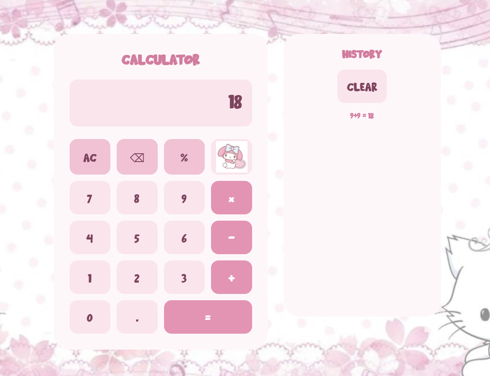

# SUMTHING

## What It Is ⋆˚࿔

A pink sanrio themed calculator I made to improve my JavaScript skills. It can do all basic calculations, and also right next to it there's a history button to see what you've calculated. Also there's My Melody looking at you from the button :3

## Why I Made It ⋆˚࿔

I actually own a Hello Kitty calculator which was a birthday gift from my friend. As someone who codes, I realised how haven't I made a calculator since that's the most common project. I didn't want it to be actually generic, so I made it pink themed :3

## How I Made It ⋆˚࿔

Tech Stack:

- HTML
- CSS
- JavaScript

My HTML skills got a bit rusty, and I ran into a lot of bugs along the way! But I feel like my vision was properly implemented!

## What I Learnt & Struggled With ⋆˚࿔

I put 'display: flex' on the body and I was so confused on why my history wasn't next to the calculator. Also, I need to be more careful with divs because I forgot to close one of them T-T Well, I learnt how flexbox really works, and that I have to put a parent of the things that I want to line up.

## Screenshot ⋆˚࿔

⠀⠀⠀⠀⠀⠀⠀⠀⠀⣼⠻⣆⠀⠀⠀⠀⠀⠀⠀⠀⠀⠀⠀
⠀⠀⡶⢤⡀⠀⠀⠀⢀⡇⡄⠈⢳⡄⠀⠀⠀⠀⠀⠀⠀⠀⠀
⠀⢠⡇⡄⢙⢦⣀⣀⣼⠁⠂⠀⠀⠙⢦⠀⠀⠀⠀⠀⠀⠀⠀
⠀⠘⡇⡇⠀⠁⡍⠁⠀⠀⠈⠁⠂⠀⢈⠳⡄⠀⠀⠀⠀⠀⠀
⠀⠰⡇⢀⠀⡐⠁⠀⠀⠀⠀⠀⢀⡴⣋⡄⠹⣆⠀⠀⠀⠀⠀
⠀⠀⣗⠈⢅⣀⣀⣀⡀⠀⠀⠀⠛⠛⠤⠤⠤⡸⣆⣠⠟⢲⡄
⠀⠀⣿⠀⠰⠒⣺⠟⠁⢀⣠⠤⠶⡄⡁⠀⢀⠆⢹⠁⣠⠞⠁
⠀⠀⢻⡀⢀⠞⠑⠒⢄⢣⡀⠀⠀⡇⠈⠉⠀⣠⣾⡜⠃⠀⠀
⢀⣤⣼⣇⠈⠠⠤⠄⠊⠀⠑⠤⢠⣃⣠⠴⢛⡿⠋⠀⠀⠀⠀
⠸⢤⣄⣈⡓⡦⠤⠤⠤⠴⠖⠚⠋⠉⠀⢸⡍⠀⠀⠀⠀⠀⠀
⠀⠀⠀⠈⠉⠉⠛⠛⠒⢷⠀⠀⠀⠀⠀⠀⢷⠀⠀⠀⠀⠀⠀
⠀⠀⠀⠀⠀⠀⠀⠀⠀⢘⡃⠀⠀⠀⠀⠀⠘⡃⠀⠀⠀⠀⠀